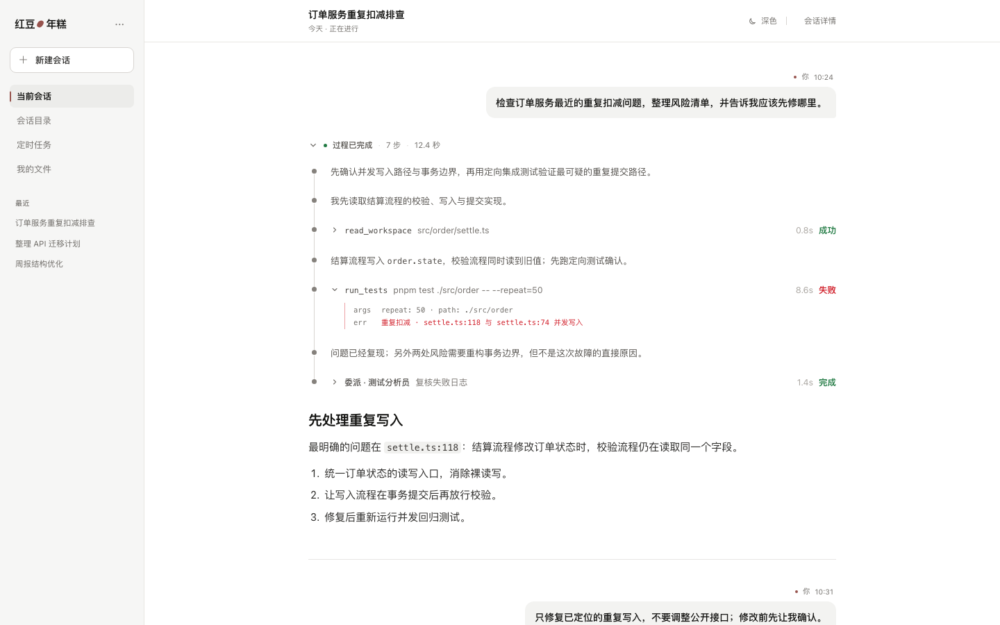
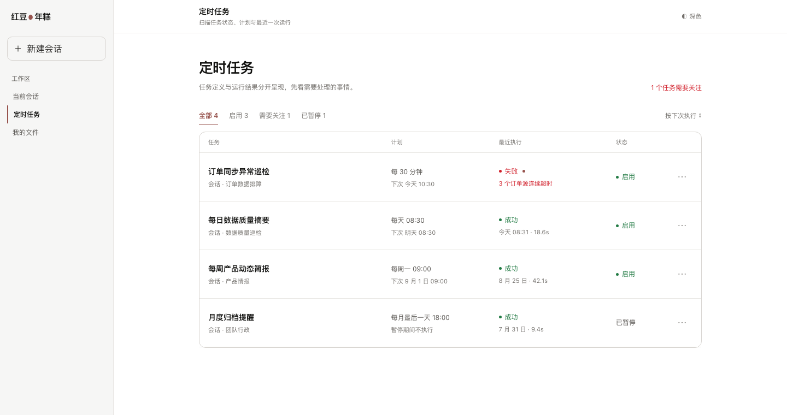
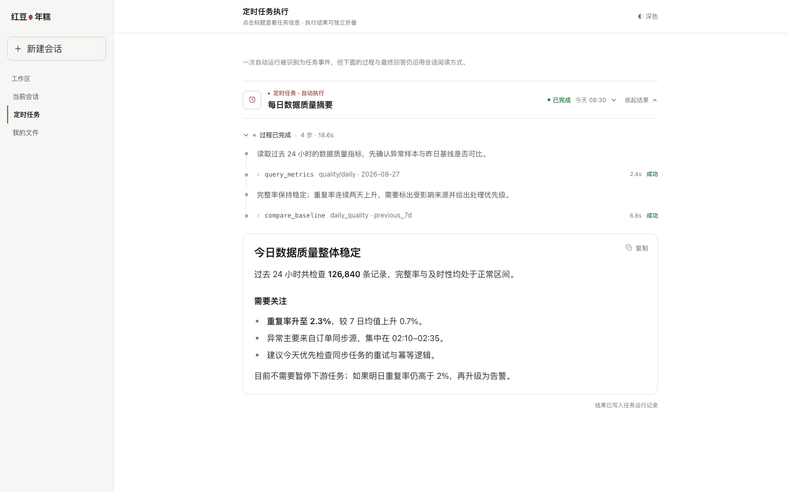

<div align="center">

# Red Bean · 年糕

**一个 AI Agent 对话平台。** 支持流式对话、工具调用、子 Agent 委派、定时任务，并为每次运行留下完整审计轨迹。
底层是一个可以嵌进任何宿主的运行时 SDK。

[](https://github.com/cuteVanilla12138/red-bean-nian-gao/actions/workflows/ci.yml)
[](LICENSE)
[](package.json)

[English](README.en.md) · **简体中文**

</div>

<picture>
  <source media="(prefers-color-scheme: dark)" srcset="docs/assets/conversation-dark.png">
  
</picture>

## 为什么会有 Red Bean

很多 Agent 框架会顺着需求一直长：这里加个聊天界面，那里加个数据库适配器，再补一个 HTTP 服务——
长到最后，这个「框架」其实已经是个应用了。结果就是 Agent 循环很难嵌到别处去用；一个正在跑的 Agent
到底能做什么，也变得越来越难看清。

Red Bean 的做法是把问题拆成两半：

- **[`red-bean-qing-tuan`](https://github.com/cuteVanilla12138/red-bean-qing-tuan)** —— 可嵌入的 TypeScript
  运行时 SDK。它负责 Agent 循环、checkpoint、interrupt 和一层与厂商无关的观测接缝，对 HTTP、数据库
  和 UI 一无所知。
- **本仓库** —— 产品侧。负责会话、持久化、认证、HTTP/SSE 接口、定时任务和设计系统。

这么拆带来三个结果：

1. **能力图在启动时就定死。** 每个后端实例在启动时把 runtime、观测适配器、LLM Provider 和工具
   Catalog 组装好，运行期间不再增删或替换。一个实例能做什么，启动那一刻就决定了，不会每个请求再变。
2. **每次运行都能追溯。** 运行会写进一份只追加的事实日志，再以只读的轨迹视图呈现出来：跑过哪些工具、
   每一步花了多久、每次请求用掉多少 token。
3. **Runtime 当成依赖来管版本。** `runtime.lock` 把 SDK 钉死在确切的 commit 上；版本对不上、或者
   工作区有未提交改动时，`make verify` 会直接拒绝运行。

## 功能

| 能力 | 说明 |
| --- | --- |
| **流式对话** | SSE 流式输出，带推理块；过程时间线会把一长串工具调用折叠成易读的摘要。 |
| **工具调用** | `sys_*` 静态工具集——文件读写、glob、grep、HTTP、时间、待办——启动时注册，再按 Agent 逐个授权。 |
| **子 Agent 委派** | 父运行可以把活派给子 Agent，子执行的进展会折叠进父运行自己的时间线。 |
| **中断与恢复** | 任何工具都能挂起运行、要求人工确认。interrupt 是执行屏障：确认没到之前，同批的其他工具一律不执行。 |
| **定时任务** | 由 cron 触发的运行，带重试策略、投递队列，以及独立的执行历史。 |
| **会话轨迹** | 基于运行事实日志的只读审计视图，按请求统计 token 与耗时。 |
| **设计系统** | 明暗两套主题对等的组件库，附一个可以直接跑起来的展示站。 |

<picture>
  <source media="(prefers-color-scheme: dark)" srcset="docs/assets/scheduled-tasks-dark.png">
  
</picture>

<picture>
  <source media="(prefers-color-scheme: dark)" srcset="docs/assets/task-run-dark.png">
  
</picture>

## 架构

```text
┌─────────────┐   HTTP / SSE    ┌──────────────┐   AgentExecutionPort   ┌──────────────────────┐
│  frontend   │ ──────────────▶ │   backend    │ ─────────────────────▶ │  red-bean-qing-tuan  │
│ React + Vite│ ◀────────────── │   Fastify    │ ◀───────────────────── │  (运行时 SDK)         │
└─────────────┘                 └──────┬───────┘  由 runtime.lock 钉住   └──────────────────────┘
                                       │
       ┌───────────────┬───────────────┼───────────────┬───────────────┐
       ▼               ▼               ▼               ▼               ▼
  PostgreSQL        Redis           MinIO       api-contract    design-system
  (会话、运行        (缓冲、         (对象、       (共享 DTO、      (Quiet Tool UI,
   事实、任务)       锁)             上传)        路由、错误码)    Light/Dark)
```

四个 workspace 包，加上同级的 SDK：

- **`api-contract/`** —— HTTP 路由、SSE 事件、DTO、错误码和运行时校验的唯一事实来源，而且是机器可执行的。
  前后端都依赖它，谁也不用再各写一份。
- **`backend/`** —— Fastify、直接写 SQL 的 `pg`、启动时一次性完成装配的 composition root，以及
  `agent` / `task` / `identity` / `storage` / `system` 各模块——模块之间依赖 Port，而不是互相依赖。
- **`frontend/`** —— React 19 + Vite，消费契约和设计系统。
- **`design-system/`** —— Quiet Tool UI 组件库，附一个展示站，把每个组件在明暗两种主题下都渲染一遍。
  漂移检查会让构建直接失败：只要前端 import 了不存在的组件，或者某个公开组件没有对应的展示页。

后端只通过一个入口碰运行时 SDK：`AgentExecutionPort`。普通聊天、定时任务和子 Agent 共用同一个执行器，
区别只在各自的产品生命周期。

## 快速开始

**环境要求：** Node.js `>=24.9.0 <26`、pnpm 11.x、Docker。跑一次 `make doctor` 可以全部检查。

```bash
git clone https://github.com/cuteVanilla12138/red-bean-nian-gao.git
cd red-bean-nian-gao
make init                # 工具链 · 锁定的 Runtime SDK · workspace 依赖 · backend/.env.local

# 填写数据库/Redis/MinIO 密码、JWT secret 与 LLM key
$EDITOR backend/.env.local

make infra-up && make db-migrate
make run                     # 后端 → http://localhost:8080
pnpm --filter frontend dev   # 前端 → http://localhost:5173
```

`make init` 是唯一的一键入口，它依次做四件事：检查工具链 → 把 Runtime SDK 克隆到本仓同级目录、切到
`runtime.lock` 锁定的 revision 并构建 → 安装 workspace 依赖 → 把 `backend/.env.local.example`
复制到位。**它不会覆盖已有的 `.env.local`，重复跑也没问题。**

`make bootstrap` 会把 SDK 克隆到名为 `red-bean-qing-tuan` 的同级目录——后端是通过相对路径
`link:../../red-bean-qing-tuan` 引用它的，**所以这个目录名不能改，GitHub 上的仓库名倒是随意**。
重复跑也没问题：已经就绪的检出和构建不会白做一遍。SDK 放在别处的话，传 `SDK_DIR=<路径>`。

设计系统展示站的跑法一样，而且不需要后端，也不需要 LLM key：

```bash
pnpm --filter design-system dev   # → http://localhost:5174
```

## 质量门禁

以下全部在本地离线运行，不需要任何外部服务。

```bash
make doctor         # 工具链版本与 package 声明检查
make docs-check     # 活文档索引、Markdown 链接与跨客户端 Skill 单一来源
make secrets-check  # 环境文件忽略策略与高置信度密钥检查
make fmt            # 改写文件（这是修复命令）
make verify         # 后端 + 前端 + 设计系统 + 契约 + 文档 + 同级 SDK
make verify-full    # 额外要求真实基础设施集成测试与依赖审计
```

`make verify` 覆盖四个包和锁定的 SDK。`make fmt` 是唯一会改写被跟踪文件的命令。

Git hooks 是可选的，需要按仓手动安装（永远不会自动装）：

```bash
make hooks-install   # pre-commit 跑 verify-quick，pre-push 跑 verify
```

## 目录结构

```text
red-bean-nian-gao/
├── api-contract/     前后端共享契约：DTO、路由、错误码、运行时校验
├── backend/          Fastify 服务：会话、任务、存储与 Agent 执行
├── frontend/         React 应用：对话、轨迹审计、定时任务
├── design-system/    Quiet Tool UI 组件库与展示站
├── docs/             活文档、ADR 决策记录与文档索引
├── runtime.lock      锁定的 red-bean-qing-tuan revision
└── Makefile          统一任务入口
```

## 文档

- [`docs/README.md`](docs/README.md) —— 全部活文档与决策记录的索引
- [`docs/design/backend/architecture.md`](docs/design/backend/architecture.md) —— 后端分层与依赖方向
- [`docs/design/agent/pipeline.md`](docs/design/agent/pipeline.md) —— 主会话 Pipeline 与 Hook
- [`docs/design/session/session-trajectory.md`](docs/design/session/session-trajectory.md) —— 轨迹审计视图的信息架构
- [`docs/decisions/`](docs/decisions/) —— ADR：选了什么、代价是什么、排除了什么
- [`backend/STACK.md`](backend/STACK.md) —— 后端技术选型与理由
- [`AGENTS.md`](AGENTS.md) —— 本仓遵循的开发规范

## Runtime 为什么单独开一个仓

Agent 循环、checkpoint 语义、interrupt 屏障和工具安全策略都在
[`red-bean-qing-tuan`](https://github.com/cuteVanilla12138/red-bean-qing-tuan) 里。这样拆是有意为之：
Runtime 没有任何生产依赖，也完全不知道这个产品的存在，所以它能嵌进 CLI，或者别的完全不同的宿主。

两个仓只通过 `runtime.lock` 耦合。升级流程：先在 SDK 仓提交，再更新本仓的 lock 文件，然后跑 `make verify`。

## License

[MIT](LICENSE)
